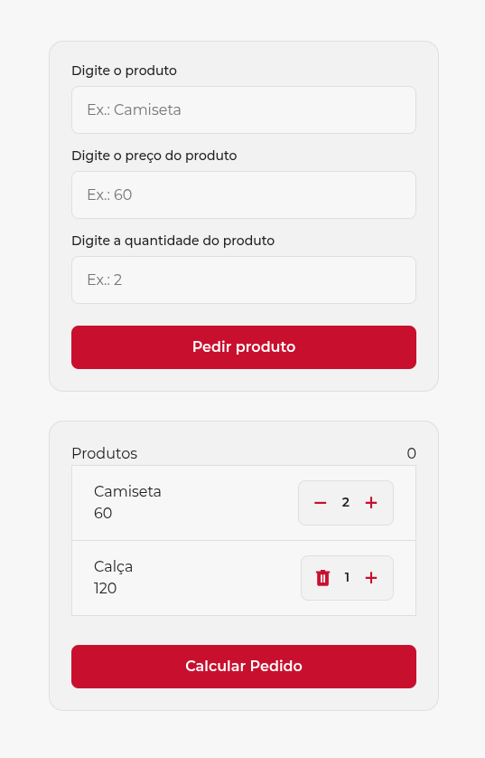

# 🛒 Carrinho de Compras


> Um gerenciador e carrinho de compras dinâmico desenvolvido com foco em arquitetura escalável de estilos e manipulação de árvore de elementos (DOM).

---

## 🚧 Status do Projeto: Em Fase Inicial / Conceitual

⏱️ **Estágio Atual:** Funcionalidades base e UI em desenvolvimento.
> O projeto encontra-se na sua etapa inicial de integração. A estrutura visual principal (HTML) e os tokens de estilização (CSS) foram implementados, e o foco atual está no desenvolvimento da lógica do JavaScript e refinamentos de espaçamento do layout.

### 🛠️ O que já foi feito:
* **Formulário de Entrada:** Campos estruturados para capturar produto, preço e quantidade.
* **Design Tokens:** Estrutura moderna de variáveis CSS dividida entre globais (`primitive.css`) e de contexto (`alias.css`).
* **Componentização Visual:** Estrutura inicial dos cards de listagem de produtos.

### 📈 Próximos Passos / O que está sendo desenvolvido:
1. **Lógica dos Contadores (`js/script.js`):** Ativar os botões de incremento (`+`) e decremento (`-`) de quantidade.
2. **Cálculo Dinâmico:** Implementar a lógica do botão "Calcular Pedido" para processar os subtotais e o total geral.
3. **Refinamento de Layout:** Ajustar o espaçamento interno, alinhamento e padding do card de listagem de produtos para garantir a consistência visual.
4. **Gerenciamento do Carrinho:** Fazer com que o botão "Pedir produto" insira dinamicamente novos itens na lista abaixo.

---

## 🚀 Tecnologias Utilizadas
<div class="teste" style="display: flex;align-items: center;gap: 8px">
    
    
    
    

</div>


---

## 📸 Demonstração & Capturas de Tela

| Interface do Formulário e Produtos |
| :---: |
|  |

---

## 🛠️ Pré-requisitos

Para rodar o projeto localmente, você precisará apenas de:
1. Um navegador web moderno (Google Chrome, Firefox, Edge ou Safari).
2. Uma extensão de servidor local no seu editor de código (como a **Live Server** para o VS Code).

---

## 🔧 Como Clonar e Executar o Projeto

```bash
# 1. Clonar o repositório
git clone https://github.com

# 2. Entrar na pasta
cd carrinho-compras
```

* **Execução:** Abra a pasta no seu editor de código e execute o arquivo `index.html` utilizando a extensão **Live Server** do seu navegador.

---

## 📂 Estrutura de Arquivos Principal

```text
carrinho-compras/
├── css/
│   ├── design-tokens/
│   │   ├── alias.css         # Variáveis de contexto/tema
│   │   └── primitive.css     # Variáveis brutas globais
│   ├── fonts.css             # Setup da tipografia Montserrat
│   └── style.css             # Estilização e layout geral
├── fonts/
│   └── Montserrat.woff2      # Fonte local otimizada
├── img/
│   └── preview.png           # Captura de tela do layout
├── js/
│   └── script.js             # [Em construção] Lógica do carrinho
├── index.html                # Estrutura semântica da aplicação
└── README.md                 # Documentação do projeto
```

---

## ✒️ Autoria & Contribuições

* **Desenvolvedor:** [Diego Peloso de Oliveira](https://github.com)
* **LinkedIn:** [Diego Peloso de Oliveira](https://www.linkedin.com/in/diego-peloso-de-oliveira/)
